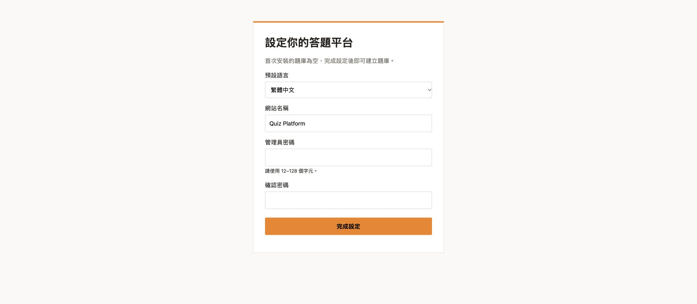
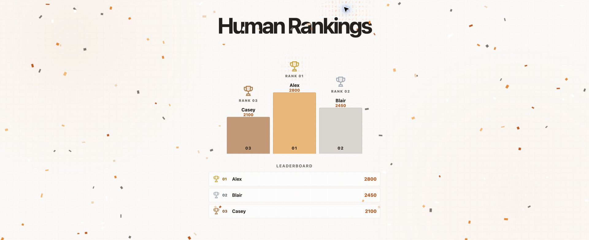

# Quiz Platform

A self-hosted live quiz for Cloudflare Workers, D1 and Durable Objects. Includes a host console, phone players, optional AI challengers, live reactions, saved results, and a read-only awards replay for screenshots.

**Every new installation starts empty.** No quizzes, questions, game history, participant records, administrator password, or deployment credentials are included.

## First local installation

Requires Node.js 24+ and npm.

```sh
npm ci
npm run dev
```

Open the Local URL printed by the dev server. The first visit opens the setup wizard:

1. Enter your site name and default language (English, 简体中文, or 繁體中文).
2. Choose and confirm an admin password of at least 12 characters. No installation key is required.
3. Sign in at `/admin`, then use **Manage Quizzes** to create your first question library.

The schema is created automatically in the local D1 database. Setup saves site configuration only; it never inserts sample quizzes. Local database state is ignored by Git.

The share link and QR code use the current site's address. Phones need to reach the deployed site; a localhost development URL is local to its computer.



## Deploy your own installation

This project uses the official `cf` CLI. It contains no account ID, custom domain, resource ID, or production binding copied from another installation.

1. Run `npm ci`.
2. Choose unique Worker and database names in `cloudflare.config.ts`. Keep the two Durable Object bindings' `worker` names equal to the Worker name.
3. Run `npx cf auth login`, then `npm run deploy`. `cf` provisions the declared D1/SQLite Durable Object resources when deploying to your account. Review the CLI's resource summary.
4. Open the deployed URL and complete the same wizard to create your admin password. Each deployed database has its own first-run configuration.
5. Optionally add your custom domain in `cloudflare.config.ts` using `worker.domains`. No domain is hardcoded in the application.

There is no default admin password. Complete the wizard immediately after first deployment; the first successful setup creates the administrator. Completed setup cannot be overwritten by submitting the wizard again. An existing deployment's data is never cleared by this repository's schema.

Deployment reference: [Cloudflare CLI projects](https://developers.cloudflare.com/cf/projects/), [programmatic configuration](https://developers.cloudflare.com/cf/projects/cloudflare-config/).

## History → Replay awards

Each saved history card has a **Replay awards** button. It opens an independent window with the original podium, trophies, leaderboard and confetti.

- **Replay animation** runs the award sequence again.
- **Humans only** filters AI players using the saved `isAI` field.
- **Screenshot mode** reveals the complete podium and freezes the current confetti frame, hiding the controls. Press **Esc** to restore them.
- The replay does not connect to a game WebSocket, save a result, reset a game or send any game command. Close its window to return to the unchanged host console.

Allow the popup when your browser asks. The following screenshot uses synthetic names and scores, not participant data.



## Administrator access

Passwords are salted and hashed with PBKDF2-SHA-256. Login returns a random 12-hour session; only its hash is stored in D1. The host keeps the session in `sessionStorage`, uses a header for HTTP API calls, and revokes it on logout. Admin WebSocket upgrades also require the session. Login attempts are rate limited. Question answers and saved history require admin authentication.

The default language changes the main host/player controls and message strings. Product names and some question-management/help text remain English; question content is entered by the host.

## Development

```sh
npm test
npm run typecheck
npm run build
```

Tests cover empty installation, key-free setup and Traditional Chinese settings, setup races/locking, password storage, session creation/expiry/revocation, throttling and request origins. The local Workers/D1 integration was also checked for empty quizzes/history and question-management permissions.

- `src/index.ts`: Worker routes and application pages
- `src/auth.mjs`: installation, passwords and sessions
- `src/setup.html`: first-run wizard
- `src/admin.html`: host console and awards replay
- `src/player.html`: phone player
- `src/room.mjs`: live game Durable Object
- `schema.sql`: empty, idempotent schema; no seeds

App code is MIT licensed. Music and third-party artwork have separate terms and attribution in [THIRD_PARTY.md](THIRD_PARTY.md).
